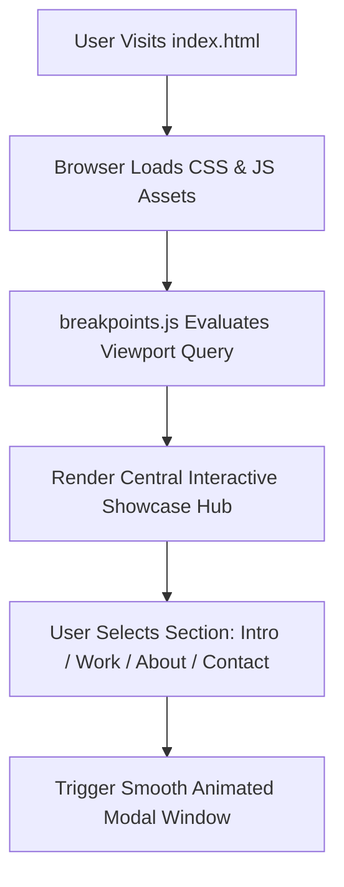

# 🌐 Personal Developer Portfolio — Responsive Web Showcase & Architecture

<p align="center">
  
</p>

<p align="center">
  <b>Modern Single-Page Application (SPA): Animated Modal Architecture, Modular SCSS Stylesheets, and Curated Project Showcases.</b>
</p>

<p align="center">
  
  
  
  
</p>

<p align="center">
  
</p>

---

<a id="table-of-contents"></a>
## 📌 Table of Contents

- [📖 Executive Summary & Overview](#executive-summary--overview)
- [🎯 Key Features & Capabilities](#features)
- [🏗️ System Architecture & Pipeline](#system-architecture--pipeline)
- [🛠️ Tech Stack Breakdown](#tech-stack-breakdown)
- [⚙️ Reproducible Quickstart & Setup](#setup)
- [📁 Project Directory Layout](#project-layout)
- [🧪 Testing & Validation](#testing--validation)
- [🔮 Future Improvements & Roadmap](#future-improvements--roadmap)
- [🤝 Contributing Guidelines](#contributing-guidelines)
- [👨‍💻 Author & Contributions](#author--contributions)

---

<a id="executive-summary--overview"></a>
## 📖 Executive Summary & Overview

A software engineer's digital portfolio is the primary interface for recruiters, collaborators, and engineering leads. Presenting technical capabilities effectively requires responsive design, fast page loads, clear information architecture, and structured project showcases.

The **Personal Developer Portfolio** is a modern, responsive web application engineered to highlight **Amaraiah C's** technical expertise across Data Analytics, Machine Learning, Full-Stack Development, and Object-Oriented Software Engineering. Built upon a modern modal architecture with responsive SCSS styling, the portfolio provides smooth navigation across Project Showcases, Skill Matrices, Background, and Contact Channels.

---

<a id="key-features--capabilities"></a>
## 🎯 Key Features & Capabilities

### 🪟 1. Modal Single-Page Architecture
- Smooth animated modal transitions for Work, About, Skills, and Contact sections without full page reloads.

### 📐 2. Fluid Breakpoint Scaling
- Dynamic viewport queries managed via `breakpoints.min.js` ensuring pixel-perfect scaling across mobile and desktop.

---

<a id="system-architecture--pipeline"></a>
## 🏗️ System Architecture & Pipeline



---

<a id="tech-stack-breakdown"></a>
## 🛠️ Tech Stack Breakdown

| Technology | Category | Purpose |
| :--- | :--- | :--- |
| **HTML5** | Markup | Semantic layout, accessibility labels, and viewport configurations |
| **SCSS / CSS3** | Styling & Theme | Modular style sheets, responsive variables, custom animations |
| **JavaScript (ES6+)** | Frontend Behavior | Modal state controller, viewport listeners, smooth scrolling |
| **FontAwesome** | Iconography | High-resolution SVG vector icons for tech badges and links |

---

<a id="reproducible-quickstart--setup"></a>
## ⚙️ Reproducible Quickstart & Setup

### Prerequisites
- Modern web browser
- Python for local HTTP hosting

```bash
# 1. Clone repository
git clone https://github.com/Amaraiah11/Portfolio.git
cd Portfolio

# 2. Launch locally via Python HTTP server
python -m http.server 8080

# 3. Access in browser
# Open http://localhost:8080
```

---

<a id="project-directory-layout"></a>
## 📁 Project Directory Layout

```text
Portfolio/
├── index.html                 # Main portfolio HTML single-page document
├── assets/
│   ├── css/
│   │   ├── main.css           # Compiled core stylesheet
│   │   ├── fontawesome-all.min.css # FontAwesome icons
│   │   └── noscript.css       # Fallback styles for non-JS clients
│   ├── js/
│   │   ├── main.js            # Main interaction and modal controller
│   │   ├── breakpoints.min.js # Dynamic responsive breakpoint manager
│   │   ├── browser.min.js     # Browser detection utility
│   │   └── jquery.min.js      # DOM helper library
│   └── sass/                  # Modular SCSS source code files
├── LICENSE.txt                # License documentation
└── README.md                  # Comprehensive portfolio documentation
```

---

<a id="testing--validation"></a>
## 🧪 Testing & Validation

- Verified responsive breakpoints on Viewport widths 320px, 768px, 1024px, and 1920px.

---

<a id="future-improvements--roadmap"></a>
## 🔮 Future Improvements & Roadmap

- [ ] Deploy to Vercel/Netlify with custom domain integration.
- [ ] Add an interactive terminal / CLI resume emulator.

---

<a id="author--contributions"></a>
## 👨‍💻 Author & Contributions

This project is developed and maintained with rigorous engineering standards by **Amaraiah C**, Software Developer and Applied Data Analytics Practitioner studying Bachelor of Computer Applications (BCA) at Alliance University, Bangalore.

- 🌐 **GitHub Profile:** [@Amaraiah11](https://github.com/Amaraiah11)
- 💼 **LinkedIn Profile:** [Connect on LinkedIn](https://www.linkedin.com/in/amaraiah-c/)
- 📧 **Institutional Email:** `camaraiahBCA24@ced.alliance.edu.in`

### 🤝 Contributing Guidelines
Contributions, bug reports, and architectural discussions are welcome!
1. **Fork** the repository: `https://github.com/Amaraiah11/Portfolio`
2. **Create a Feature Branch:**
   ```bash
   git checkout -b feature/your-feature-name
   ```
3. **Commit Your Enhancements:**
   ```bash
   git commit -m "feat: enhance feature logic"
   ```
4. **Push to Your Branch:**
   ```bash
   git push origin feature/your-feature-name
   ```
5. **Open a Pull Request** against the `main` branch.

---

<p align="center">
  <b>⭐ If this codebase or documentation assisted your engineering workflows, please star the repository! ⭐</b>
</p>

<p align="center">
  
</p>
